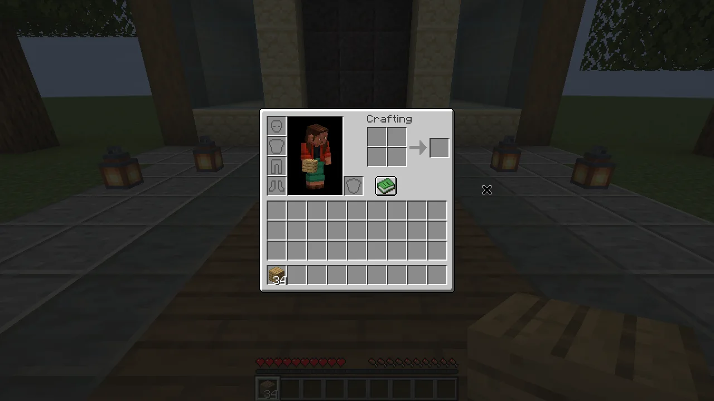
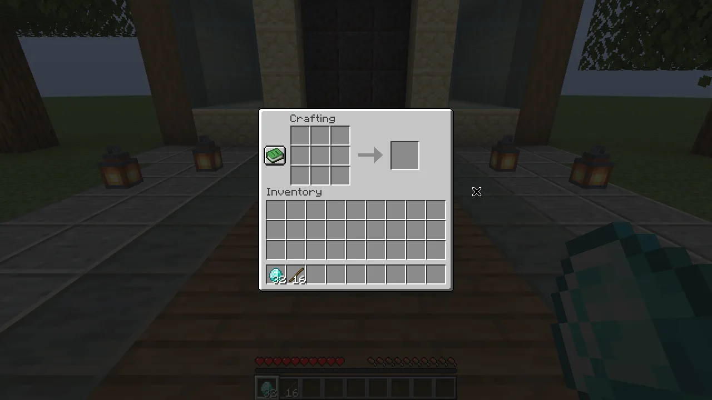
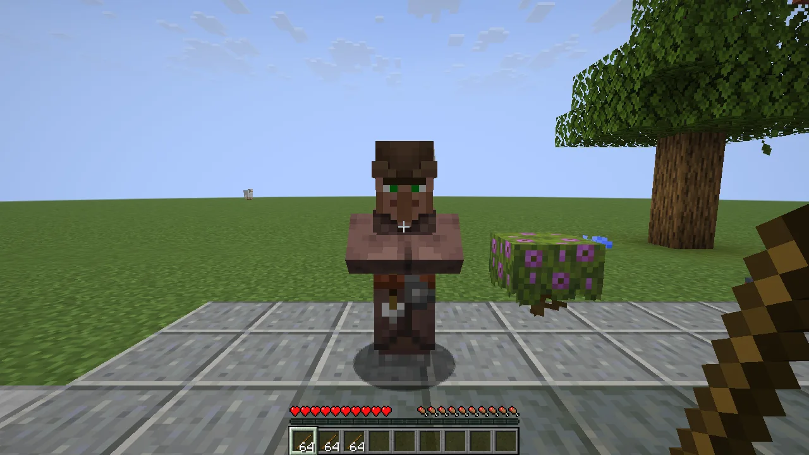
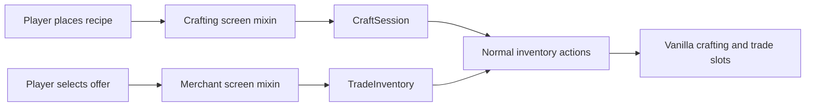

<div align="center">
<h1>Hold Craft</h1>
<hr>
<p><strong>3 supported screens in one place: inventory crafting, crafting tables, villager trading.</strong></p>
<p>


</p>
<p>
<a href="https://github.com/hhhhhffd/HoldCraft/releases"></a>

<a href="LICENSE"></a>
</p>
<p><a href="https://github.com/hhhhhffd/HoldCraft/releases">Download</a> · <a href="#architecture">Architecture</a> · <a href="#build">Build</a></p>
<p>Inventory crafting</p>

<p>Crafting table</p>

<p>Villager trading</p>

</div>

## Overview

Hold Craft is a client-side mod for repeating a recipe you placed or a villager trade you selected. It uses normal inventory actions and stops when the inputs, output space or screen state no longer support the operation.

## Technical Stack

| Area | Technology | Version / role |
| --- | --- | --- |
| Runtime | Minecraft Java | 1.21.11 |
| Runtime | Fabric Loader | 0.18.4 or later; client only |
| Runtime | Java | 21 or later |
| Build | Fabric Loom / Gradle | 1.13.6 / 9.2.1 |

## Architecture



- Screen mixins connect controls to existing inventory and merchant screens, without a server-side mod.
- `CraftSession` tracks the recipe and transfers one ingredient at a time, checking the grid and inventory as it proceeds.
- Trading uses vanilla payment slots and inventory actions rather than custom packets or bypassing trade limits.

## Project Structure

```text
.
├── build.gradle          # Loom build and dependencies
├── gradle.properties     # Minecraft and tool versions
├── gradle/wrapper/       # Gradle wrapper configuration
├── src/client/           # Crafting session, trade logic and mixins
├── src/main/             # Fabric metadata and resources
└── docs/media/           # Demonstrations
```

## Installation

1. Install Minecraft Java 1.21.11 with Fabric Loader 0.18.4 or later and Java 21 or later.
2. Download the JAR from [releases](https://github.com/hhhhhffd/HoldCraft/releases) and place it in the client's `mods` folder.

Fabric API and server-side mods are not required.

## Usage

### Crafting

1. Lay out the recipe normally in the 2×2 inventory grid or a 3×3 crafting table.
2. Take a result manually. If it consumed ingredients, faint ingredient hints appear in newly empty slots; these hints are only drawn on screen.
3. Empty the cursor and hold the small **Hold** button directly above the result. The mod tops up the same occupied positions and crafts one result at a time into the main inventory or hotbar.
4. Release the button, drag off it, close the screen or click another slot to stop.

Auto-crafting also stops on insufficient ingredients or output space, invalid results, or unexpected changes to the grid or inventory. The mod matches the exact items and components you placed; it does not substitute another wood type or rearrange real items in the grid. It places only one ingredient per missing slot and finishes each small transfer before starting the next.

> [!NOTE]
> Recipes with ordinary container remainders, such as buckets, are left to manual crafting.

### Villager trades

Select an offer manually in the vanilla merchant screen, then click **Auto Trade** below the result. The selected deal repeats at a paced interval using normal payment slots and items from your inventory. Click **Stop** to cancel.

Changing the offer, using another control, closing the screen, a changed price, exhausted stock, unaffordable payment or insufficient result room also stop trading. The mod does not bypass trade limits or send custom packets.

## Build

Use Java 21 and the included Gradle wrapper:

```sh
./gradlew build
```

On Windows, use `gradlew.bat build`.

## Links

- [Source](https://github.com/hhhhhffd/HoldCraft)
- [Releases and downloads](https://github.com/hhhhhffd/HoldCraft/releases)
- Demos: [inventory crafting](docs/media/inventory-crafting.webp), [crafting table](docs/media/crafting-table.webp), [villager trading](docs/media/villager-trading.webp)

## License

[MIT](LICENSE).
